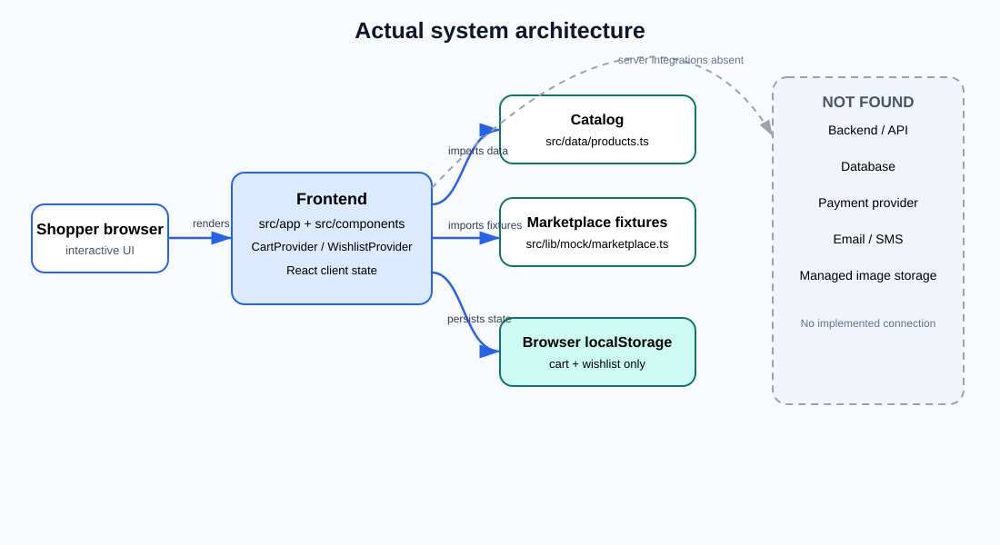
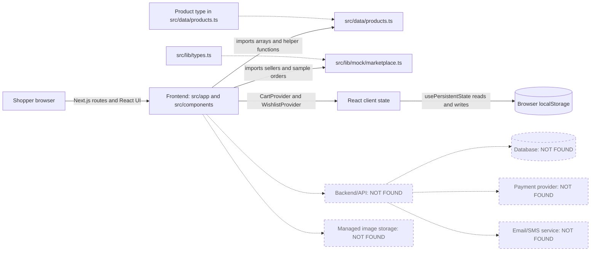
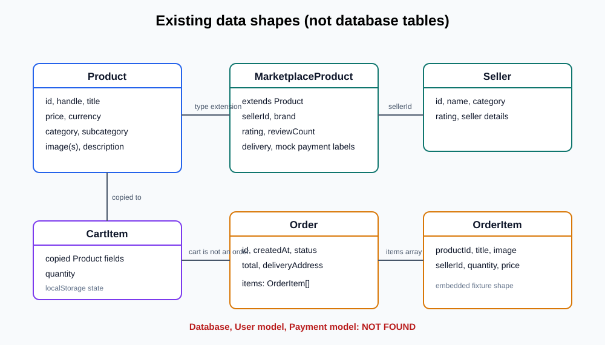
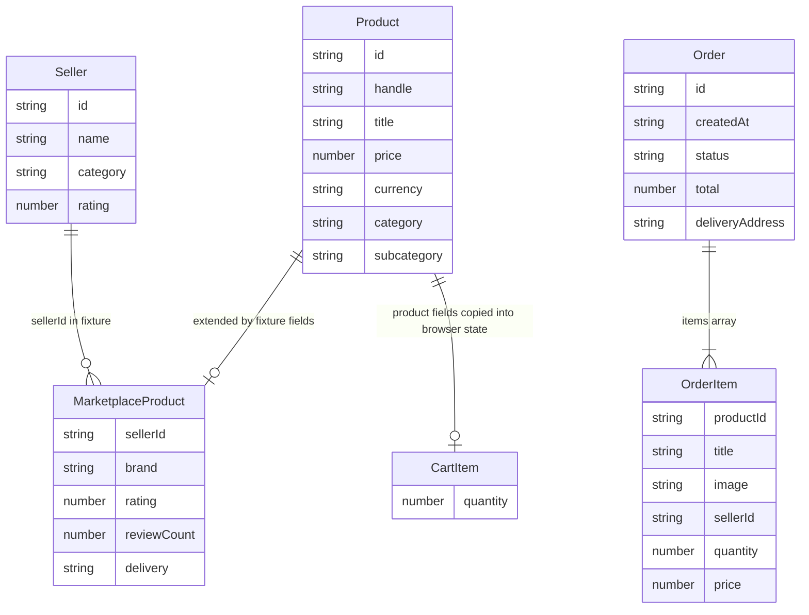
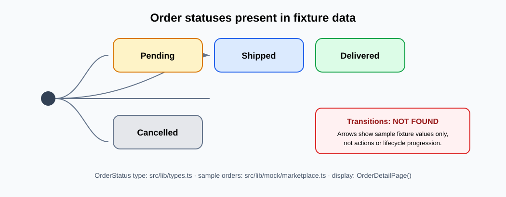
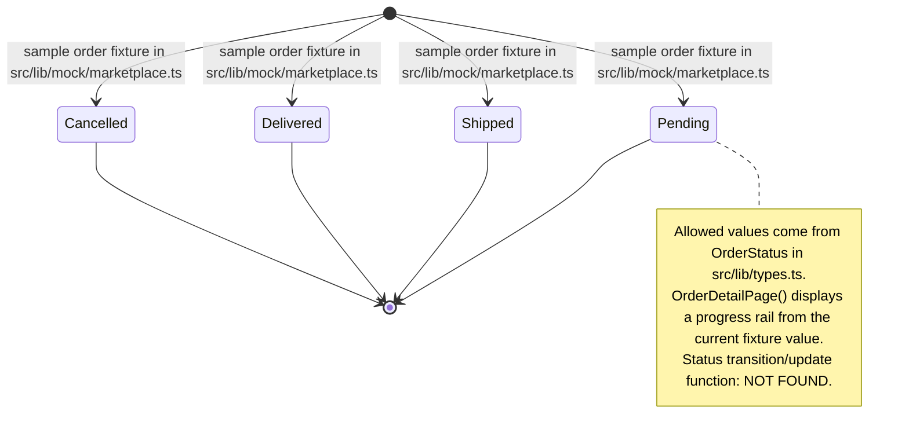
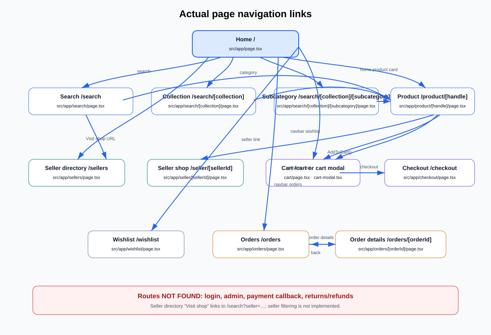

# Actual system diagrams

These diagrams describe the repository code as inspected. The word “model” below means a TypeScript type or fixture shape, not a database table. NOT FOUND means no implementation was found in this repository. No speculative connection is drawn.

## 1. System architecture





The dotted lines only point to named missing components; they are not integrations. Product image URLs are present in fixtures, but an image storage service integration is NOT FOUND. Payment labels in fixture metadata are not a payment integration.

## 2. Data model / ER diagram



No database or database tables exist in the repository. The diagram shows only TypeScript data shapes found in src/data/products.ts and src/lib/types.ts, with their fixture relationships.



There are no User or Payment types/models: NOT FOUND. CartItem is a client-side type and localStorage value, not a persisted table. The Order-to-OrderItem association is an embedded items array in sample data, not a database foreign key. The product/catalog and seller/order records are static arrays, not persisted rows.

## 3. Checkout and payment sequence


```mermaid
sequenceDiagram
  actor Shopper
  participant UI as CheckoutPage (src/app/checkout/page.tsx)
  participant Cart as CartProvider (src/components/cart/cart-context.tsx)
  participant Persist as usePersistentState (src/lib/use-persistent-state.ts)
  participant Browser as Browser localStorage
  participant Pay as Payment service (NOT FOUND)
  participant Orders as Order persistence (NOT FOUND)

  UI->>Cart: CheckoutPage() reads cart, cartTotal, clearCart via useCart()
  Note over UI,Cart: CartProvider() computes cartTotal = sum(item.price × item.quantity) in browser
  UI->>UI: CheckoutPage() computes orderTotal = cartTotal + selected delivery fee
  Shopper->>UI: Submit form
  UI->>UI: handleSubmit() prevents default and sets isSubmitting
  UI->>UI: handleSubmit() timer sets submitted and clears cart
  UI->>Cart: clearCart() sets cart to []
  Cart->>Persist: CartProvider state update triggers usePersistentState effect
  Persist->>Browser: localStorage.setItem("acme-cart", JSON.stringify(value))
  UI-->>Shopper: Local demo confirmation; no payment processed
  UI-xPay: Payment request/verification NOT FOUND
  UI-xOrders: Persisted order creation NOT FOUND
```

The arrow functions are client-side display/state operations. In particular, there is no server checkout endpoint, persisted order, or payment confirmation. “Paystack” and “COD” in src/lib/mock/marketplace.ts describe mock product metadata only.

## 4. Order status state diagram





The arrows from the initial node mean “a sample fixture may already have this status”; they do not describe status changes. No transition rules or admin action exist in the code.

## 5. Page navigation flow



```mermaid
flowchart TD
  Root[Home / — src/app/page.tsx]
  Root -->|navbar/search links; SearchAutocomplete()| Search[Search /search — src/app/search/page.tsx]
  Root -->|category links| Collection[Collection /search/[collection] — src/app/search/[collection]/page.tsx]
  Root -->|home ProductCard links| Product[Product /product/[handle] — src/app/product/[handle]/page.tsx]
  Search -->|ProductCard link| Product
  Collection -->|product card link| Product
  Product -->|ProductDescription seller Link| Seller[Seller shop /seller/[sellerId] — src/app/seller/[sellerId]/page.tsx]
  Root -->|navbar/footer| Sellers[Seller directory /sellers — src/app/sellers/page.tsx]
  Sellers -->|SellerCard Visit shop URL| Search
  Product -->|AddToCart() opens cart modal| CartModal[Cart modal — src/components/cart/cart-modal.tsx]
  CartModal -->|checkout Link| Checkout[Checkout /checkout — src/app/checkout/page.tsx]
  Root -->|navbar cart link| Cart[Cart /cart — src/app/cart/page.tsx]
  Cart -->|checkout Link| Checkout
  Root -->|navbar| Wishlist[Wishlist /wishlist — src/app/wishlist/page.tsx]
  Root -->|navbar/footer| Orders[Orders /orders — src/app/orders/page.tsx]
  Orders -->|order details Link| Order[Order details /orders/[orderId] — src/app/orders/[orderId]/page.tsx]
  Order -->|back Link| Orders
  Checkout -->|confirmation home Link| Root
  Root -->|navbar category/subcategory links| Subcategory[Subcategory /search/[collection]/[subcategory] — src/app/search/[collection]/[subcategory]/page.tsx]
  Subcategory -->|ProductCard link| Product
```

Routes such as login, admin, account/profile, payment callback, and return/refund pages are NOT FOUND. Seller shop “Follow shop”, order “Track order”, and “Return item” controls have no navigation/action handler in their pages. The seller directory card’s Visit shop link points to /search?seller=…; no seller query filtering is implemented in SearchPage(), so it is not drawn as a functioning seller-filter transition.
