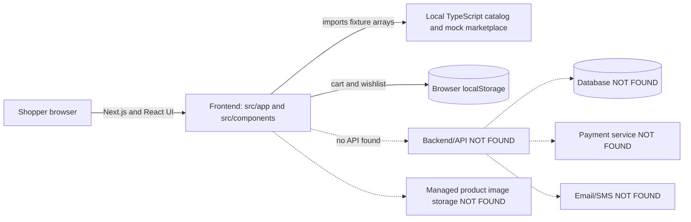

# Generalstore repository review

## Scope

Read-only review of repository source. “NOT FOUND” means no implementation was found in the repository. No secret values are included. Paths are relative to the repository root.

# Part A — Understand it

## 1. What the project does (5 sentences)

Generalstore is a browser storefront prototype with a hard-coded catalog, marketplace home feed, product detail pages, category browsing, and text search. The home feed combines promotions, sample seller data, and product fixtures. A shopper can add catalog items to a cart and save products to a wishlist, both kept in that browser's localStorage. It includes synthetic seller storefronts and sample order history/tracking screens. Checkout only shows a confirmation in the browser; there is no live server, database, payment collection, or order creation flow in this repository.

## 2. Tech stack

| Piece | Purpose | Evidence |
|---|---|---|
| Next.js App Router (`^16.4.0-canary.58` in package.json) | Routes, server-rendered pages, static generation. | package.json; src/app pages and generateStaticParams functions |
| React 19 | UI and interactive state/context. | package.json; client components in src/components and src/app |
| TypeScript | Product, seller, order, and component types. | tsconfig.json; src/lib/types.ts; src/data/products.ts |
| Tailwind CSS 3, PostCSS, Autoprefixer | Utility styling and CSS processing. | tailwind.config.ts; postcss.config.mjs; src/app/globals.css |
| clsx | Class-name helper dependency; direct use NOT FOUND in source. | package.json |
| Local TypeScript arrays | Catalog and marketplace demo records. | src/data/products.ts; src/lib/mock/marketplace.ts |
| Browser localStorage | Saves cart and wishlist on this browser/device. | src/lib/use-persistent-state.ts; cart/wishlist providers |

No API/backend, authentication, database client/ORM, email/SMS integration, cloud storage integration, or payment SDK was found. package.json has dev/build/start/lint scripts and no test script. scripts/ exists but no files were found in the shallow inventory.

## 3. Top-level folders and important files

| Folder | Purpose; key files |
|---|---|
| .github/ | Agent and hook configuration. .github/agents/impeccable-asset-producer.agent.md; .github/agents/impeccable-documenter.agent.md; .github/skills/impeccable/SKILL.md |
| .impeccable/ | Design metadata. .impeccable/design.json (only file found). |
| .next/ | Generated Next.js output, not source. |
| .vscode/ | Editor settings. .vscode/settings.json (only file found). |
| node_modules/ | Installed dependencies, not project feature source. |
| public/ | Static assets. Directory exists; files NOT FOUND in shallow inventory. |
| scripts/ | Utility scripts. Files NOT FOUND in shallow inventory. |
| src/ | Application. Key: src/app/layout.tsx (shared shell); src/data/products.ts (catalog/filter); src/lib/mock/marketplace.ts (seller/product/order fixtures). |
| src/app/ | Routes and global CSS. Key: src/app/layout.tsx; src/app/page.tsx; src/app/checkout/page.tsx. |
| src/components/ | Reusable UI and providers. Key: src/components/cart/cart-context.tsx; src/components/wishlist/wishlist-context.tsx; src/components/layout/navbar.tsx. |
| src/data/ | Catalog and category data. src/data/products.ts (only file found). |
| src/lib/ | Shared types, persistence and mock data. Key: src/lib/types.ts; src/lib/use-persistent-state.ts; src/lib/mock/marketplace.ts. |

Important component subfolders: components/cart (cart-context.tsx, cart-modal.tsx); components/grid (product-grid.tsx, product-card.tsx, three-item-grid.tsx); components/home (general-home.tsx and general-home.css power the active home page; home-sections.tsx, redline-sections.tsx, flash-sale-shelf.tsx, hero-carousel.tsx, category-grid.tsx, and product-shelf.tsx are other compositions); components/layout (navbar.tsx, footer.tsx, search/collections.tsx); components/marketplace (search-results.tsx, search-autocomplete.tsx, seller-card.tsx); components/product (product-description.tsx, add-to-cart.tsx, gallery.tsx); components/wishlist (wishlist-context.tsx).

## 4. How pieces connect

Solid arrows exist in source; dashed connections are requested ecommerce components not found.

src/app/layout.tsx wraps UI in CartProvider and WishlistProvider. Both providers use src/lib/use-persistent-state.ts. Product images are URL strings in fixtures; image hosting/storage integration was not found.

## 5. Database and relationships

There is no database and no database tables/models in the repository. These are TypeScript data shapes, not persisted database models:

| Concept | Shape/data | Relationship |
|---|---|---|
| User | NOT FOUND; no auth/user model. | No ownership link. |
| Product | Product in src/data/products.ts: id, handle, title, description, price, currency, images, category/subcategory/collections. | In-memory catalog. |
| Seller | Seller in src/lib/types.ts; records in src/lib/mock/marketplace.ts. | Marketplace product has sellerId. |
| Cart | CartItem = Product plus quantity in src/components/cart/cart-context.tsx. | Browser-local copied product data. |
| Order | Order and OrderItem in src/lib/types.ts; hard-coded orders in src/lib/mock/marketplace.ts. | Order embeds item snapshots; no user ID or persistence. |
| Payment | NOT FOUND. | Checkout explicitly says no payment is collected. |

Users → Cart → Orders → Payments relations are NOT FOUND. The fixture relationships are seller-to-marketplace-product via sellerId, and order-to-embedded-items via items[].

## 6. Main flows

### Login

Login route, form, user model, session, and authentication function: NOT FOUND.

### Browsing and searching products

1. src/app/page.tsx, HomePage(), passes catalog, flash-sale products, sellers, and categories into GeneralHome() in src/components/home/general-home.tsx; GeneralHome() renders the active home feed.
2. Category data/helpers live in src/data/products.ts; src/components/layout/navbar.tsx and src/components/layout/search/collections.tsx render navigation.
3. /search is handled by src/app/search/page.tsx, SearchPage(), which reads query params and calls getFilteredProducts().
4. getFilteredProducts() in src/data/products.ts filters in-memory product fields by substring and sorts. Collection/subcategory routes call it in src/app/search/[collection]/page.tsx and src/app/search/[collection]/[subcategory]/page.tsx.
5. src/components/marketplace/search-results.tsx and src/components/grid/product-grid.tsx render cards.
6. src/app/product/[handle]/page.tsx, ProductPage(), calls getProduct(handle), builds gallery and related products; ProductDescription() renders details/variant-like choices.

### Add to cart

1. AddToCart() in src/components/product/add-to-cart.tsx is used by ProductDescription() in src/components/product/product-description.tsx.
2. It calls addToCart(product) from useCart() in src/components/cart/cart-context.tsx.
3. CartProvider() adds/increments the item and opens the modal. src/lib/use-persistent-state.ts saves it in localStorage.
4. src/components/cart/cart-modal.tsx or src/app/cart/page.tsx, CartPage(), displays it; updateQuantity() and removeFromCart() change browser state.

### Checkout and totals

1. CheckoutPage() in src/app/checkout/page.tsx reads cart/cartTotal from useCart().
2. CartProvider() computes cartTotal in the browser as sum(price × quantity). CheckoutPage() adds a fixed configured pickup/home-delivery fee.
3. HTML-required contact fields are collected. handleSubmit() prevents default, waits briefly, shows local submitted state, then clears cart.
4. It creates no order and has no server-side validation or server-calculated total.

### Payment and confirmation

Payment SDK/API, server verification, webhook, and persisted confirmation: NOT FOUND. CheckoutPage() says “demo checkout, no payment collected”; handleSubmit() only updates client state and clears local cart.

### Order status changes

1. Sample statuses are hard-coded in orders in src/lib/mock/marketplace.ts; OrderStatus is in src/lib/types.ts.
2. OrdersPage() in src/app/orders/page.tsx filters that list; OrderDetailPage() in src/app/orders/[orderId]/page.tsx renders progress from its fixed status.
3. Status mutation/admin actions are NOT FOUND. Track order and Return item buttons in OrderDetailPage() have no handlers.

### Admin features

Admin route, role, dashboard, catalog/inventory editor, order management, and status mutation are NOT FOUND.

## 7. Every page and its sections, top to bottom

| Name | Route | File | Sections from top to bottom |
|---|---|---|---|
| Home | / | src/app/page.tsx | GeneralHome: rotating hero; quick links; flash-sale rail; recently searched queries and matches; category promo rails; top sellers; category-filtered product feed; cart summary; shared footer. |
| Search | /search?q=…&sort=… | src/app/search/page.tsx | Search layout; title; search/filter/results (SearchResults); footer. |
| Collection | /search/[collection] | src/app/search/[collection]/page.tsx | CategoryLanding with subcategory tiles, deal/new/bestseller rails, brand tiles, sort links, and products; `official-store` renders OfficialStores. |
| Subcategory | /search/[collection]/[subcategory] | src/app/search/[collection]/[subcategory]/page.tsx | Search layout; product grid/title/description; footer. |
| Product | /product/[handle] | src/app/product/[handle]/page.tsx | Gallery; product details and variant-like controls/add-to-cart; related products; footer. |
| Cart | /cart | src/app/cart/page.tsx | Loading or empty state; cart items and quantity/removal; summary and checkout link. |
| Checkout | /checkout | src/app/checkout/page.tsx | Progress steps; contact/address form; delivery selection; totals; submit/local confirmation. |
| Wishlist | /wishlist | src/app/wishlist/page.tsx | Empty state or saved count and product grid. |
| Orders | /orders | src/app/orders/page.tsx | Account heading; status tabs; sample order cards; empty state. |
| Order detail | /orders/[orderId] | src/app/orders/[orderId]/page.tsx | Back link; status; delivery progress; items; help box with inert tracking/return buttons. |
| Seller directory | /sellers | src/app/sellers/page.tsx | Intro; category/rating filters; seller cards. |
| Seller storefront | /seller/[sellerId] | src/app/seller/[sellerId]/page.tsx | Seller profile/metrics/follow button; product heading; products. |

src/app/layout.tsx adds a shared navbar and footer around routes. The search layout adds padding and width constraints, not a second footer. Unknown product, seller, or order IDs call Next.js notFound().

# Part B — What is missing

“Complete” means a usable implementation exists within this prototype’s scope; it does not mean production-ready. Effort is a rough estimate for building a real marketplace implementation.

| Feature | Status | Evidence | Effort |
|---|---|---|---|
| Product variants | Partial | ProductDescription() in src/components/product/product-description.tsx displays color/size choices, but handleAdd() calls addToCart(product) without selected values; Product has no variant model in src/data/products.ts. | M |
| Search and filters | Partial | SearchPage() and getFilteredProducts() in src/app/search/page.tsx and src/data/products.ts do text matching and sorting; SearchResults() has local price/category/rating/delivery/payment controls. Client filters do not represent a scalable catalog search and sort display says Relevance. | M |
| Reviews | Partial | Ratings/review counts/breakdowns are generated fixture values in src/lib/mock/marketplace.ts and displayed by ProductDescription(); review records, writing, moderation, and verified purchase are NOT FOUND. | M |
| Wishlist | Complete (prototype) | WishlistProvider(), toggleWishlist(), and useWishlist() in src/components/wishlist/wishlist-context.tsx persist to localStorage; WishlistPage() lists saved products. Not account-synced. | S |
| Coupons | Missing | Coupon model, validation, and checkout field NOT FOUND in src/app/checkout/page.tsx. | M |
| Guest checkout | Partial | CheckoutPage() accepts contact fields with no login gate; handleSubmit() only simulates completion and creates no order. | M |
| Multiple addresses | Missing | CheckoutPage() has one transient name/address/city/zip form; address book/model NOT FOUND. | M |
| Delivery fee by location | Missing | CheckoutPage() uses fixed $0 pickup and $4.99 home fee regardless of address. | M |
| Card payment | Missing | “Paystack” occurs only as mock product payment-method metadata/search filter; no checkout payment integration or verification. | L |
| Bank transfer | Missing | Transfer method and bank reconciliation flow NOT FOUND. | M |
| Pay on delivery | Partial | COD appears in fixture metadata and search filter; actual checkout selection/collection flow NOT FOUND. | M |
| Order tracking | Partial | OrderDetailPage() renders fixed sample status progress; live carrier events/tracking ID/action NOT FOUND. | M |
| Returns/refunds | Missing | “Return item” button has no handler in OrderDetailPage(); return/refund workflow NOT FOUND. | M |
| Inventory management | Missing | stockLeft/stockTotal in src/lib/types.ts and src/lib/mock/marketplace.ts are display fixtures; no stock mutation/reservation or admin inventory function. | L |
| Vendor/seller features | Partial | Seller directory/storefront and seller fixture data exist in src/app/sellers/page.tsx, src/app/seller/[sellerId]/page.tsx, src/lib/mock/marketplace.ts; seller onboarding, sign-in, product/order management, and payouts NOT FOUND. | L |
| Admin dashboard | Missing | Admin route, authorization role, and management functions NOT FOUND. | L |
| Email/SMS notifications | Missing | Checkout confirmation explicitly says no email was sent; provider/integration NOT FOUND. | M |
| SEO | Partial | Root metadata in src/app/layout.tsx and product static params exist; product-specific metadata, sitemap, robots, canonical URLs, and structured product data NOT FOUND. | M |
| Mobile responsiveness | Partial | Tailwind responsive layouts and mobile filter drawer are present in components/search-results.tsx and page components; no automated device/accessibility checks were found. | S |
| Tests | Missing | No test/spec files or test script/framework were found in package.json/repository file inventory. | M |

# Part C — What needs improvement

| Severity | Location | Problem | Why it matters | Suggested fix | Effort |
|---|---|---|---|---|---|
| Critical | src/components/cart/cart-context.tsx: CartProvider(); src/app/checkout/page.tsx: CheckoutPage(), handleSubmit() | Prices, quantities, cart total, delivery fee, and order total are calculated in browser state. Cart data is editable in localStorage/devtools; no server recalculates it. | A shopper can change browser values, and there is no trustworthy total for a real charge/order. | Add a server checkout endpoint that accepts product IDs/quantities, reloads current prices and eligibility, validates quantity/fees, computes integer minor-unit totals, and returns a quote/order. | L |
| Critical | src/app/checkout/page.tsx: handleSubmit(); payment verification code NOT FOUND | Checkout confirms locally and clears cart without payment. There is no server verification or amount-to-order comparison. | A frontend confirmation cannot prove money was received; the current UI is unsuitable for live transactions. | Integrate provider server-side, create payment against persisted order amount, verify signed callback/webhook and amount/currency/order ID, then mark paid idempotently. | L |
| High | src/lib/mock/marketplace.ts: marketplaceProducts; stock fields in src/lib/types.ts | No stock reduction, reservation, or transaction. stockLeft is display-only fixture data. | Two shoppers could both buy the last item in a future implementation; current prototype does not enforce stock at all. | Store inventory in a database; atomically reserve/decrement with a conditional update and expire reservations. | L |
| High | src/app/orders/page.tsx: OrdersPage(); src/app/orders/[orderId]/page.tsx: OrderDetailPage(); src/lib/mock/marketplace.ts: orders | No authentication or user ownership. Current order list is fixed demo data and all order IDs are statically addressable; user-specific order access control is NOT FOUND. | There is no private user data yet, but adding real orders without ownership checks could expose or allow changes to another shopper’s order. | Add authenticated sessions and enforce order.userId ownership on every server read/mutation; avoid exposing private order details in public static generation. | L |
| Medium | src/components/product/product-description.tsx: ProductDescription(), handleAdd() | Color and size are UI-only; selected variant is discarded when adding to cart. | Shopper can select one option but cart receives none, so fulfilment cannot know what was ordered. | Model valid variants with SKU, availability, and price; require selection where applicable and persist variant ID in cart/order. | M |
| Medium | src/components/marketplace/search-results.tsx: SearchResults(); src/data/products.ts: getFilteredProducts() | Some filters exist only in client memory; server-rendered category/search results and filters can disagree. Search is substring matching over a small array, with no pagination. | Filtering becomes slow/unreliable as catalog grows and filter state is hard to share/bookmark. | Move filtering/sorting into a server query/API, validate query params, add pagination and database search indexes when a database exists. | M/L |
| Medium | src/app/checkout/page.tsx: CheckoutPage(), FormField(), handleSubmit() | HTML required fields are the only validation; no server validation, address normalization, or submission error state exists. | Client checks can be bypassed and bad data can become orders once persistence is added. | Validate all inputs server-side with a schema; display field-specific errors and handle network/provider failures. | M |
| Medium | src/app/orders/[orderId]/page.tsx: OrderDetailPage() | Track order and Return item buttons have no handlers; displayed progress is derived from fixture status. | Controls imply actions that do not happen. | Link to implemented carrier/return workflows or disable/remove controls until the workflow exists. | M |
| Medium | src/lib/use-persistent-state.ts: usePersistentState() | Storage errors are silently ignored; cart/wishlist are per browser and unvalidated JSON is cast to the expected type after parse. | Corrupt/tampered client data can yield invalid quantities or UI failures; shoppers lose state between devices. | Validate persisted shape and bounds; report recoverable errors; sync to account after authentication if desired. | S/M |
| Medium | src/app/layout.tsx: metadata; product page metadata NOT FOUND | Only generic site metadata is defined; dynamic products/categories lack specific SEO metadata and structured product data. | Search engines and social previews get generic information and product rich results are unavailable. | Add generateMetadata() per product/category, canonical URLs, sitemap/robots, and valid structured data based on server catalog data. | M |
| Medium | Test coverage NOT FOUND; package.json scripts | No automated test suite or test command was found. | Checkout math, filtering, variant behavior, and future payment/authorization protections can regress unnoticed. | Add unit tests for pure catalog/total logic and integration tests for checkout, auth ownership, stock concurrency, and payment webhook verification. | M |
| Low | src/app/search/[collection]/page.tsx and src/app/search/[collection]/[subcategory]/page.tsx | Both contain substantially duplicated category/subcategory filtering and rendering logic. | Fixes can drift between routes and duplicate code is harder to maintain. | Extract a shared route data helper/component while retaining distinct parameter behavior. | S |
| Low | Slow queries/indexes | Database queries and indexes are NOT FOUND because there is no database; current fixture filtering is linear over a small array in src/data/products.ts. | No current database query bottleneck can be assessed; linear scans will not scale to a large catalog. | Reassess after database adoption; index category, seller, price, status, and searchable fields based on actual query patterns. | M |
| Low | Secret/config scan: .env files and process.env references NOT FOUND | No env file appeared in the file inventory and no process.env usage was found in app/config source. Hard-coded secret values were NOT FOUND in searched source. | External integrations should not embed credentials in browser code. | When adding providers, use deployment environment secrets and server-only modules; never use NEXT_PUBLIC for private keys. | S |

## Direct answers to the requested checks

- **Server-calculated prices/totals?** No. `CartProvider()` in src/components/cart/cart-context.tsx computes cartTotal client-side; CheckoutPage() in src/app/checkout/page.tsx adds a client-side fee. A browser user can change cart product fields/quantities.
- **Server-verified payment and amount check?** NOT FOUND. No payment integration or server endpoint exists; checkout states that no payment is collected.
- **Stock handling / last item race?** No stock mutation or reservation found. Sample stock counts are static; concurrent purchasing is not implemented.
- **Can one user see/change another user's orders?** There are no users or real private orders. The hard-coded sample order pages are not scoped to a user. Authorization for future real orders is NOT FOUND.
- **Secrets?** No .env file was found in the repository file inventory, no process.env references were found in searched source/config, and no hard-coded secrets were found in that search. Secret values were not read or printed.
- **Quality checks?** Two category route files duplicate logic; checkout validation is client/HTML-only; storage errors are swallowed; test files/scripts are NOT FOUND. Database queries/indexes are NOT FOUND, so database performance cannot be assessed.

# Part D — Action plan

## Top 10, in priority order

1. Keep checkout explicitly in demo mode until a server order/payment path exists; do not treat local confirmation as a paid order. (src/app/checkout/page.tsx: handleSubmit())
2. Build server-side authoritative checkout pricing and quantity validation from product IDs. (Current browser total in src/components/cart/cart-context.tsx: CartProvider())
3. Add persisted orders and authentication, then enforce ownership for every order read/change. (Current fixture pages: src/app/orders/page.tsx and src/app/orders/[orderId]/page.tsx)
4. Add payment provider integration with server-side amount/currency/order verification and idempotent webhook handling. (Payment verification NOT FOUND)
5. Add transactional stock reservation/decrement and out-of-stock handling. (Current fixture counts in src/lib/mock/marketplace.ts)
6. Make the seller directory's "Visit shop" link show that seller's products; it currently links to `/search?seller=...`, but search does not read a seller parameter. (src/components/marketplace/seller-card.tsx; src/app/search/page.tsx)
7. Persist selected variants through cart and order lines. (src/components/product/product-description.tsx: handleAdd())
8. Add server-validated checkout addresses and location-based delivery pricing; support saved addresses. (src/app/checkout/page.tsx: CheckoutPage())
9. Build real returns/refunds and order tracking, or remove inert controls until implemented. (src/app/orders/[orderId]/page.tsx: OrderDetailPage())
10. Add automated tests for pricing, checkout, payment, authorization, stock concurrency, and product search. (Tests NOT FOUND)

## Highest-priority follow-up

- Items 1–5: keep demo checkout clearly separate from real payment, then add authoritative server pricing, order ownership, payment verification, and safe stock updates before using the app for real transactions. Item 6 is a separate storefront navigation gap.

## Build next (features)

- Items 7–9: real product variants, address/delivery rules, and order tracking/returns; then build vendor and admin tools, coupon validation, reviews, and email/SMS notifications.

## Clean up later

- Item 10 and maintainability tasks: tests; deduplicate category route logic; improve persistence validation/error reporting; add SEO metadata; tune database indexes once a real database and measured query patterns exist.
